# Crawler

The `crawler` crate discovers and extracts generic product evidence from enabled `WEB_CRAWL` ListingSources. It has its own Postgres state for domains, URLs, schemas, retries, budgets, and review artifacts.

It is not a ProductListing writer and holds no business database credentials. It reads its ListingSource scope from the admin API and submits immutable raw observations to the shared product-listing ingestion queue; the normalization Lambda is the sole authority that turns raw evidence into canonical ProductListings after CDC activation. The crawler does not query canonical ProductListing tables, create ProductListing events, or assign Parties, sellers, auctioneers, auctions, or lot facts. R17 crawler-local scheduling, review and raw-capture completion remain independent of the worker transport: an accepted submission is not proof of capture, and a capture is not proof of normalization.

## Flow

```mermaid
flowchart LR
    Source[Admin API: WEB_CRAWL ListingSources] --> Sync[Local crawler scope]
    Sync --> Spider[Spider]
    Spider --> Urls[Local URL state]
    Urls --> Scraper[Scraper]
    Scraper --> Raw[Immutable raw observation]
    Raw --> Queue[Ingestion FIFO queue]
    Queue --> Capture[Ingestion consumer: transactional raw capture]
    Capture --> CDC[DMS / Kinesis router after approved start]
    CDC --> SQS[Normalization SQS queue]
    SQS --> Normalizer[ProductListing normalization Lambda]
```

Each spider or scraper pass first refreshes the complete ListingSource scope from the admin API. A failed or partial refresh skips that pass; a scope is applied only whole. `crawl_enabled` admits work only; disabling a source retains its crawler history and configuration.

A ListingSource keeps its business identity from the authoritative source. The crawler never derives it from a domain or URL. Crawler domains are operator state; with [domain seeding](operations.md#runtime-prerequisites) switched on, a scope refresh registers the public host the admin API presents for a source that has no domains yet, through the same registration an operator uses, and never replaces one. It mirrors only the local work scope, including `WEB_CRAWL` enablement and an optional fallback currency. The fallback applies only when an extracted price has no currency hint. The admin API does not return it, so a scope refresh leaves the locally stored value unchanged; it stays crawler-local until normalization resolves it from the source's `WEB_CRAWL` configuration.

## Local state

Crawler-local Postgres is authoritative for crawler operations:

- configured domains and crawl roots;
- discovered URL class, disposition, scrape fingerprint, and retry metadata;
- cached product and removed-page schemas;
- LLM budget accounting; and
- review artifacts and their audit state.

A URL belongs to one configured `(listing_source_id, domain_id)` pair. Exact URLs cannot move between domains or sources. Removing a domain removes its URL state and domain-scoped URL-pattern reviews.

Crawler IDs exposed by the review service use TypeIDs: domains `cd`, reviews `cr`, review pages `crp`, and review URLs `cru`. Postgres stores their backing UUIDs. See [object IDs](../object-ids.md).

## Binaries

- `server` runs the scheduled crawler and review console. It reads its scope from the admin API and submits raw observations to the ingestion queue; it needs no business database.
- `dev` runs the same crawler locally against demo ListingSources, writes raw observations to a file, and needs neither AWS nor the API.
- `dev-spider` and `dev-scraper` are focused development entry points for their respective passes.
- `fetch-fixture` saves source HTML for stable parser and schema snapshots; it is not a production ingestion path.
- `review-mcp` serves the review console's tools to one review agent of `agent` authoring mode as an MCP server over stdio; see [review MCP server](operations.md#review-mcp-server).
- `review-agent-runner` works the pending reviews with the author and reviewer agents of `agent` authoring mode, one headless Claude Code CLI process per review and role; see [review agent runner](operations.md#review-agent-runner).

`server` and `dev` share one composition root, [`crawler::runtime`](../../src/crawler/src/runtime.rs). Each binary supplies only its ListingSource source, raw-capture sink, cron settings, review-console settings and state directory, so new crawler dependencies are wired there rather than in a binary. They stay separate binaries so local fixtures and the tokenless review console never ship in `server`.

## Boundaries

- [ListingSource API contract](../swagger.yaml) defines business source identity, `WEB_CRAWL` configuration and the admin search the crawler reads its scope from.
- [ProductListing event flow](../events/flow.md#productlisting-write-flow) owns raw capture and normalization.
- [Workspace architecture](../arch.md) owns dependency and authority rules.
- [Networking](networking.md), [scheduling and retries](scheduling-and-retries.md), [extraction and review](extraction-and-review.md), and [operations](operations.md) define crawler-specific contracts.
