# Crawler

The `crawler` crate discovers and extracts generic product evidence from enabled `WEB_CRAWL` ListingSources. It has its own Postgres state for crawl roots, URLs, schemas, retries, budgets, and review artifacts.

It is not a ProductListing writer and holds no business database credentials. It reads its ListingSource scope from the admin API and submits immutable raw observations to the shared product-listing ingestion queue; the normalization Lambda is the sole authority that turns raw evidence into canonical ProductListings after CDC activation. The crawler does not query canonical ProductListing tables, create ProductListing events, or assign Parties, sellers, auctioneers, auctions, or lot facts. R17 crawler-local scheduling, review and raw-capture completion remain independent of the worker transport: an accepted submission is not proof of capture, and a capture is not proof of normalization.

## Flow

```mermaid
flowchart LR
    Source[Admin API: WEB_CRAWL ListingSources] --> Sync[Local crawler scope]
    Sync --> Spider[Spider]
    Spider --> Urls[Local URL state]
    Urls --> Scraper[Scraper]
    Scraper --> Raw[Immutable raw observation]
    Raw --> Queue[Ingestion FIFO queue]
    Queue --> Capture[Ingestion consumer: transactional raw capture]
    Capture --> CDC[DMS / Kinesis router after approved start]
    CDC --> SQS[Normalization SQS queue]
    SQS --> Normalizer[ProductListing normalization Lambda]
```

Each spider or scraper pass first refreshes the complete ListingSource scope from the admin API. A failed or partial refresh skips that pass; a scope is applied only whole. `crawl_enabled` admits work only; disabling a source retains its crawler history and configuration.

## ListingSource scope

A ListingSource is the crawler's only entity. It keeps its business identity from the authoritative source, and the crawler mirrors only its work scope: `WEB_CRAWL` enablement and the crawl root. Nobody configures crawl roots; each scope refresh derives them ([`crawl_root.rs`](../../src/crawler/src/crawl_root.rs)):

- The crawl root is the presentation URL the admin API gives the source, on `https`, without credentials, query or fragment. Its path is the start page; its host without one leading `www.` is the crawl host, the scope the spider stays on and the host that owns the source's URLs.
- A source whose presentation URL is missing or names no domain host on the default port, or whose crawl host another crawl-enabled source of the scope presents (a marketplace), gets no crawl root. It is neither crawled nor scraped, and the refresh warns `crawler.listing_source_crawl_skipped` once per source and reason. Crawling a shared host needs a path-scoped crawl root, which the crawler does not have.
- A refresh that gives a source another crawl root moves it: the crawl state of the old root (last crawls, failure and truncation counts, rate-limit hold, crawl outcome) and its frontier are cleared, so the next spider cycle crawls the new root in full. The source's URLs, URL pattern and scrape state stay. A run of the old root that is still crawling records nothing over the move.
- A source that leaves the scope keeps its crawl root and history with `crawl_enabled = false`, and resumes from them when it returns with the same URL.
- A human, or in `agent` mode the author agent on the review it works, can label a source the crawler should not crawl: a site that is not an online shop (`NOT_AN_ESHOP`), one the crawler's approach does not fit (`APPROACH_NOT_APPLICABLE`), or one kept out of reach by `BOT_PROTECTION`, `JAVASCRIPT_RENDERED` pages or a `LOGIN_REQUIRED`, or for an `OTHER` reason its note names. Labelling sets `crawl_enabled = false` and the refresh keeps a labelled source disabled however the scope admits it, so it costs no crawl, scrape, review-agent or LLM budget and never needs attention; it keeps its crawl root, URLs, schemas and reviews. Only a human clears a label; clearing resets the source's crawl failure streak, and the next refresh enables it again. The label is crawler-local operator state, not a business attribute of the ListingSource; the console contract is in [operations](operations.md#review-service).

Two crawl-enabled sources never share a crawl host; the schema refuses it.

## Local state

Crawler-local Postgres is authoritative for crawler operations:

- crawl roots and the crawl and scrape state of each ListingSource;
- discovered URL class, disposition, scrape fingerprint, and retry metadata;
- cached product and removed-page schemas;
- LLM budget accounting; and
- review artifacts and their audit state.

A URL belongs to one ListingSource and lies on its crawl host. Exact URLs cannot move between sources.

Crawler IDs exposed by the review service use TypeIDs: reviews `cr`, review pages `crp`, review URLs `cru` and review events `cre`. Postgres stores their backing UUIDs. See [object IDs](../object-ids.md).

## Binaries

- `server` runs the scheduled crawler and review console. It reads its scope from the admin API and submits raw observations to the ingestion queue; it needs no business database.
- `dev` runs the same crawler locally against demo ListingSources, writes raw observations to a file, and needs neither AWS nor the API.
- `dev-spider` and `dev-scraper` are focused development entry points for their respective passes.
- `fetch-fixture` saves source HTML for stable parser and schema snapshots; it is not a production ingestion path.
- `review-mcp` serves the review console's tools to one review agent of `agent` authoring mode as an MCP server over stdio; see [review MCP server](operations.md#review-mcp-server).
- `review-agent-runner` works the pending reviews with the author and reviewer agents of `agent` authoring mode, one headless Claude Code CLI process per review and role; see [review agent runner](operations.md#review-agent-runner).

`server` and `dev` share one composition root, [`crawler::runtime`](../../src/crawler/src/runtime.rs). Each binary supplies only its ListingSource source, raw-capture sink, cron settings, review-console settings and state directory, so new crawler dependencies are wired there rather than in a binary. They stay separate binaries so local fixtures and the tokenless review console never ship in `server`.

## Boundaries

- [ListingSource API contract](../swagger.yaml) defines business source identity, `WEB_CRAWL` configuration and the admin search the crawler reads its scope from.
- [ProductListing event flow](../events/flow.md#productlisting-write-flow) owns raw capture and normalization.
- [Workspace architecture](../arch.md) owns dependency and authority rules.
- [Networking](networking.md), [scheduling and retries](scheduling-and-retries.md), [extraction and review](extraction-and-review.md), and [operations](operations.md) define crawler-specific contracts.
