# Crawler

The `crawler` crate discovers and extracts generic product evidence from enabled `WEB_CRAWL` ListingSources. It has its own Postgres state for crawl roots, URLs, schemas, retries, budgets, and review artifacts.

It is not a ProductListing writer: its business database role may only enqueue ingestion commands and can read or write no table. It reads its ListingSource scope from the admin API and submits immutable raw observations to the shared product-listing ingestion queue; the normalization worker is the sole authority that turns raw evidence into canonical ProductListings. The crawler does not query canonical ProductListing tables, create ProductListing events, or assign Parties, sellers, auctioneers, auctions, or lot facts. R17 crawler-local scheduling, review and raw-capture completion remain independent of the worker transport: an accepted submission is not proof of capture, and a capture is not proof of normalization.

## Flow

```mermaid
flowchart LR
    Source[Admin API: WEB_CRAWL ListingSources] --> Sync[Local crawler scope]
    Sync --> Spider[Spider]
    Spider --> Urls[Local URL state]
    Urls --> Scraper[Scraper]
    Scraper --> Raw[Immutable raw observation]
    Raw --> Queue[Ingestion FIFO job queue in PostgreSQL]
    Queue --> Capture[Ingestion consumer: transactional raw capture]
    Capture --> Outbox[Delivery outbox and dispatcher]
    Outbox --> Scope[Normalization job scope]
    Scope --> Normalizer[ProductListing normalization worker]
```

Each spider or scraper pass first refreshes the complete ListingSource scope from the admin API. A failed or partial refresh skips that pass; a scope is applied only whole. `crawl_enabled` admits work only; disabling a source retains its crawler history and configuration.

## ListingSource scope

A ListingSource is the crawler's only entity. It keeps its business identity from the authoritative source, and the crawler mirrors only its work scope: `WEB_CRAWL` enablement and the crawl root. Nobody configures crawl roots; each scope refresh derives them ([`crawl_root.rs`](../../src/crawler/src/crawl_root.rs)):

- The crawl root is the presentation URL the admin API gives the source, on `https`, without credentials, query or fragment. Its path is the start page; its host without one leading `www.` is the crawl host, the scope the spider stays on and the host that owns the source's URLs.
- A source whose presentation URL is missing or names no domain host on the default port, or whose crawl host another crawl-enabled source of the scope presents (a marketplace), gets no crawl root. It is neither crawled nor scraped, and the refresh warns `crawler.listing_source_crawl_skipped` once per source and reason. Crawling a shared host needs a path-scoped crawl root, which the crawler does not have.
- A refresh that gives a source another crawl root moves it: the crawl state of the old root (last crawls, failure and truncation counts, rate-limit hold, crawl outcome) and its frontier are cleared, so the next spider cycle crawls the new root in full. The source's URLs, URL pattern and scrape state stay. A run of the old root that is still crawling records nothing over the move.
- A source that leaves the scope keeps its crawl root and history with `crawl_enabled = false`, and resumes from them when it returns with the same URL.
- A human, or in `agent` mode the author agent on the review it works or the [qualifier](#listingsource-qualification), can label a source the crawler should not crawl: a site that sells nothing online (`NOT_AN_ESHOP`), one that sells online but not art or antiques (`NOT_AN_ANTIQUE_SHOP`), a shop whose product URLs no URL pattern tells apart (`URL_PATTERN_APPROACH_NOT_APPLICABLE`) or whose product pages no product schema extracts reliably (`PRODUCT_SCHEMA_APPROACH_NOT_APPLICABLE`), one whose robots.txt refuses the crawler (`ROBOTS_DISALLOWED`, a refused permission, not a technical block), one that is parked, for sale or closed (`SHOP_CLOSED`, never for one failed fetch), one kept out of reach by `BOT_PROTECTION`, `JAVASCRIPT_RENDERED` pages or a `LOGIN_REQUIRED`, or one with an `OTHER` reason its note names. An approach label set on a review must name that review's artifact type. `APPROACH_NOT_APPLICABLE` is retired: labels that carry it stay valid and keep their source disabled, but no new label may use it. Labelling sets `crawl_enabled = false` and the refresh keeps a labelled source disabled however the scope admits it, so it costs no crawl, scrape, review-agent or LLM budget and never needs attention; it keeps its crawl root, URLs, schemas and reviews. A new label replaces the source's label, and every label set, replaced or cleared is appended to the source's append-only label history in the same transaction, so no label or note is ever lost. Only a human clears a label; clearing resets the source's crawl failure streak and [qualifies](#listingsource-qualification) the source, and the next refresh enables it again. The label is crawler-local operator state, not a business attribute of the ListingSource; the console contract is in [operations](operations.md#review-service).

Two crawl-enabled sources never share a crawl host; the schema refuses it.

## ListingSource qualification

The crawler crawls real art and antiques e-shops only: sites that sell art or antiques online. Antique and vintage collectibles count as antiques; ordinary second-hand goods, new collectibles and reproductions do not. In `agent` mode Claude decides each ListingSource's qualification before the source's first crawl, through the [qualifier](operations.md#review-agent-runner), and the scope refresh enables a source only once it is qualified ([`listing_source_registration.rs`](../../src/crawler/src/service/listing_source_registration.rs)). Each refresh records which sources it admits with a crawl root; those without a qualification form the qualification queue.

- The qualifier reads the source's own pages through the crawler's network, with its user agent and obeying robots.txt, and decides in this order, stopping at the first step that fails: robots.txt allows the crawler, by its rules and a `Crawl-delay` of at most 60 seconds (`ROBOTS_DISALLOWED`), the shop is still there (`SHOP_CLOSED`), it sells online (`NOT_AN_ESHOP`), it sells art or antiques (`NOT_AN_ANTIQUE_SHOP`; a mixed shop qualifies when they are a significant part of what it sells). A source that fails a step is `DISQUALIFIED` with that step's label, which switches its crawling off. A real art and antiques e-shop is `QUALIFIED`, with a label only when the crawler cannot crawl it for one of the other reasons.
- It fails closed: a source the qualifier cannot decide, such as an unreachable site without proof that it closed, is `NEEDS_HUMAN` and is not crawled until it is decided. A `NEEDS_HUMAN` decision and a cleared qualification switch the source's crawling off in their own transaction, a backfill source's included, so no crawl or review of it starts before the next refresh; only the refresh enables a source. Since most such sites are unreachable for the moment only, the agents try a source again a day after their own `NEEDS_HUMAN`, with its note as evidence, up to three `NEEDS_HUMAN` since a human last decided or cleared its qualification; after that it waits for a human. Every decision carries a note naming its evidence.
- A crawl root that moves to another presentation URL clears the source's qualification and its backfill pass, so the new site is qualified before it is crawled.
- A review agent never clears a label. Qualifying a labelled source without a label keeps the label, and the source stays disabled until a human clears it. A human decides or clears any source's qualification on the console; a human's qualification without a label clears the source's label, and clearing a qualification puts the source back in the queue, uncrawled until it is decided again, unless a human set its label.
- Every source the scope admitted when qualification was introduced joins a one-off backfill (a source then out of scope that returns later waits like a new one): it keeps being crawled while it waits for its first qualification, and that one decision may replace a label a human set before qualification existed; the decision ends the source's backfill. Outside the backfill the queue holds no source whose label a human set, and an agent's decision or review label that would replace a human's label is refused.
- Every decision and clear is appended to the source's append-only qualification history in its transaction.
- In the other authoring modes no agent qualifies sources and the refresh does not wait for a qualification; humans can still decide one. Switching to `manual` therefore lifts the gate.

## Local state

Crawler-local Postgres is authoritative for crawler operations:

- crawl roots and the crawl and scrape state of each ListingSource;
- discovered URL class, disposition, scrape fingerprint, and retry metadata;
- cached product and removed-page schemas;
- LLM budget accounting; and
- review artifacts and their audit state.

A URL belongs to one ListingSource and lies on its crawl host. Exact URLs cannot move between sources.

Crawler IDs exposed by the review service use TypeIDs: reviews `cr`, review pages `crp`, review URLs `cru` and review events `cre`. Postgres stores their backing UUIDs. See [object IDs](../object-ids.md).

## Binaries

- `server` runs the scheduled crawler and review console. It reads its scope from the admin API and submits raw observations to the ingestion queue through a business database role that may only enqueue.
- `dev` runs the same crawler locally against demo ListingSources, writes raw observations to a file, and needs neither AWS nor the API.
- `dev-spider` and `dev-scraper` are focused development entry points for their respective passes.
- `fetch-fixture` saves source HTML for stable parser and schema snapshots; it is not a production ingestion path.
- `review-mcp` serves the review console's tools to one review agent of `agent` authoring mode as an MCP server over stdio; see [review MCP server](operations.md#review-mcp-server).
- `review-agent-runner` works the pending reviews with the author and reviewer agents of `agent` authoring mode, one headless Claude Code CLI process per review and role; see [review agent runner](operations.md#review-agent-runner).

`server` and `dev` share one composition root, [`crawler::runtime`](../../src/crawler/src/runtime.rs). Each binary supplies only its ListingSource source, raw-capture sink, cron settings, review-console settings and state directory, so new crawler dependencies are wired there rather than in a binary. They stay separate binaries so local fixtures and the tokenless review console never ship in `server`.

## Boundaries

- [ListingSource API contract](../swagger.yaml) defines business source identity, `WEB_CRAWL` configuration and the admin search the crawler reads its scope from.
- [ProductListing event flow](../events/flow.md#productlisting-write-flow) owns raw capture and normalization.
- [Workspace architecture](../arch.md) owns dependency and authority rules.
- [Networking](networking.md), [scheduling and retries](scheduling-and-retries.md), [extraction and review](extraction-and-review.md), and [operations](operations.md) define crawler-specific contracts.
