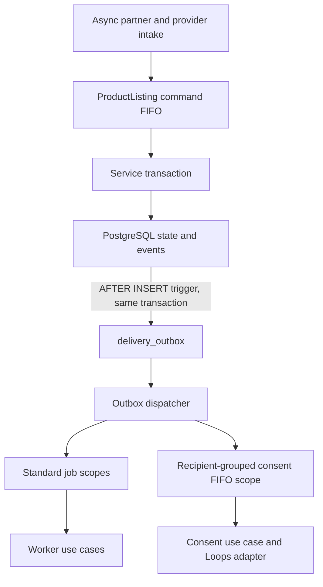

# Event flow

This document owns event sources, routing and consumer completion semantics.
[Architecture](../arch.md#12-outbox-queue-and-projection-architecture) owns general rules;
the [worker runbook](../durable-worker-runbook.md) owns recovery.
Code and configuration define exact codecs and resource settings, not live state.

## Delivery paths

Command admission and committed-change delivery are separate boundaries. An API
success may confirm a transaction or queue custody; neither implies search visibility
or external delivery. PostgreSQL remains authoritative. Capture is part of the writer's
transaction: a committed source insert always has its outbox row, and a rolled-back one has
none. The outbox, the [job queue](../../src/platform-postgres-queue/README.md) and their custody
tables are the whole delivery path; nothing outside PostgreSQL holds work in transit.
Changing a selected source's routed columns needs the capture trigger, the dispatcher's codec
and the route to change together, under a new snapshot version when stored rows could still
carry the old shape. The [delivery outbox](../../src/delivery-outbox/README.md) owns
dispatch mechanics and the [worker runbook](../durable-worker-runbook.md#delivery-outbox-recovery)
owns recovery.

## Account identity deletion

Account removal atomically appends `user_identity_deletion_requests`. The outbox captures
only its deleted user ID; provider identities and delivery state stay outside the outbox. Inserts
route schema-1 `USER_IDENTITY_DELETION` jobs to the isolated `user-identity-deletion`
standard scope. The worker rereads retained identity state and acknowledges only committed
completion. Unknown targets, active claims and uncertain provider effects remain retryable.
[Account lifecycle](../account-lifecycle.md) owns provider and re-registration rules;
[worker recovery](../durable-worker-runbook.md#user-identity-deletion-recovery) owns redrive.

## Shipping management signals

[Shipping](../shipping.md#immutable-management-change-signals) owns version 1 immutable
profile/default signals, retained deletion fences and protected history. Only the
minimal address-free signals atomically coalesce durable shipping dependency work.
Terms, evidence, creation receipts and original signals are never captured by the outbox.
Only `listing_shipping_wakeups` (work UUID and positive bigint generation) is selected;
schema-1 `LISTING_SHIPPING` jobs target the isolated `listing-shipping` worker scope.
Workers reread current committed dependencies and checkpoint bounded pages. See the
[projection contract](../shipping.md#effective-shipping-discovery-projection) and
[recovery runbook](../durable-worker-runbook.md#listing-shipping-recovery).

## ProductListing write flow

- Partner writes commit canonical state and at most one semantic event atomically.
  The immutable domain/enrichment journal is the projection source, not a generic
  outbox or an event-sourced aggregate. [ProductListing](../product-listing.md) owns
  lifecycle, sale-observation and event meaning.
- Crawler and provider observations capture separate raw evidence and immutable
  revisions. Only ordered normalization turns those revisions into canonical state
  and events. It preserves listing-owned Auction/lot facts; it does not mutate Auctions.
- Raw-revision jobs are wake-ups: normalization drains the authoritative stream head
  and commits terminal progress with any canonical change. Invalid candidate data
  may be terminally rejected; dependency/configuration failures leave work pending.
  Capped or unfinished drains are not complete. There is no scheduled raw-backlog reconciler.
- Normalized withdrawals may supply a validated `sourceListingId`. The service resolves
  the listing by source and product identity in the canonical write transaction, checking
  any existing stream binding. Without an explicit identity, a withdrawal uses that binding.
  Unknown products complete without creating a listing; ordering fences remain effective.
- Optional [crawler shipping assertions](../shipping.md#deterministic-crawler-item-assertions)
  apply through the existing delivery use case after catalog normalization commits.
  Their failures do not undo terminal raw progress. Existing shipping change and validity
  signals retain their ordinary transaction boundaries.
- Async partner commands, mapped Shopify/WooCommerce observations and crawler raw
  observations use the separate `product-listing-ingestion` FIFO scope of the job queue. The consumer commits canonical state/event or raw capture
  together with its successful command receipt. [Admission, execution and retry identity](../product-listing.md#asynchronous-ingestion-submission)
  are independent of downstream normalization and projection.
- Provider observations of one source record are ordered by provider source time. An
  older observation completes as stale. Provider clocks are often second-precise, so
  distinct observations with an equal source time keep FIFO admission order, except that
  an upsert never overtakes a delete with the same source time. A delete without a source
  time sets a barrier at the later of its capture time and every source time already known
  for the record; only an observation with a later source time moves past it, earlier ones
  complete as stale and a timestamp-free upsert is rejected. The barrier compares provider
  and database clocks: provider skew can delay a restore until the next edit, or let an
  update older than the delete by less than the skew restore the listing.

### Shopify channel observations

Catalog intake accepts `product_listings/add`, `product_listings/update` and
`product_listings/remove`, scoped to the subscribing app's sales channel. Add/update
snapshots use `product_listing.product_id`, without product `status`; stock exhaustion
updates availability and does not withdraw the listing. Remove requires only that exact
positive unsigned 64-bit product identity. The mapper preserves it exactly and emits a
validated decimal `sourceListingId` in raw values for both upsert and delete. Source
identity always includes the `ListingSourceId`.
A first remove resolves an initially imported listing through the service's source/product lookup;
unknown products retain their ordering fence without creating a canonical listing.

`SHOPIFY_PRODUCT` payload schema 1 retains the nested listing snapshot, stripping
`body_html` inside `product_listing` (and at the outer level). Raw values use schema 1.
Unsupported schemas fail closed. Broad `products/*` topics are acknowledged
without forwarding.

Shopify delivers these topics over HTTPS to [`POST /v1/webhooks/shopify`](../swagger.yaml).
The API verifies `X-Shopify-Hmac-Sha256` over the exact body with the app client secret
(current or, during rotation, previous) before reading anything else, maps the delivery
headers to the observation's provenance and answers `200` only after confirmed command
admission. A malformed or unmappable delivery is `400`; uncertain admission is `5xx` and
Shopify retries it for about four hours. A longer outage is recovered by re-importing.

`X-Shopify-Triggered-At` supplies webhook source-time ordering independently
of product `updated_at`, using the existing provider ordering and deletion-barrier rules
above. The HMAC covers only the body, so the header is unauthenticated: a value more than
five minutes ahead of the host clock or older than six hours (Shopify's four-hour retry
horizon plus margin for a delayed first attempt) is rejected with `400`, so a replayed
`remove` body cannot set a far-future deletion barrier. The required `X-Shopify-Webhook-Id`
keys the provider receipt and the command identity, so Shopify's retries of one delivery deduplicate. Separate subscriptions deliver
one event under different webhook IDs; equal listing state then collapses during capture.
The retained raw provenance keeps `eventBridgeEventId`, which is `null` for HTTPS deliveries.

Initial/manual/recovery imports use the existing canonical asynchronous upsert and
withdrawal endpoints. The app owns publication reads: imports upsert published products
and withdraw only drafts, archived products and unpublished products present in the
export, each by its own ID, never by absence. An empty export submits no withdrawals.
Missing access/publication and failed or partial reads are recoverable errors.

Bulk writes and webhooks have no shared ordering guarantee. An older import can restore
a product removed by a later webhook; an older withdrawal can remove a product republished
later. This overlap is an accepted limitation, and importing again is the recovery path.
Existing idempotency keys prevent duplicate command application; they do not establish
publication chronology.

App companion [#370](https://github.com/aura-historia/shopify-app/issues/370) owns
publication filtering, subscription/scope changes and imports through the existing API.
Recheck the current publication when resolving a reported mismatch.

## Geography dependency invalidation

Party service owns `party_location_changes`; ListingSource service owns
`listing_source_location_default_changes`. Each minimal immutable revision signal commits
with its authoritative semantic mutation. Default signals contain source/operator and
optional location identities, assignment/location revision, applicability flags, actor
and occurrence time, without address, point or evidence. Duplicate current-revision
no-ops emit nothing; clearing emits a null selection and preserves the ordering fence.
Location/default rows and receipts are never captured by the outbox. Exact persistence and
inheritance semantics belong to [geography](../geography.md#listingsource-location-defaults-2000).

These signals atomically establish coalesced durable listing-geography work. The
`listing_geography_wakeups` table alone adds outbox capture and job routing; the original journals stay
outside capture. Consumers reread current authority under dependency equality guards and
use the listing's monotonic projection fence. Location correction, retirement,
source replacement/clear and provider rights/expiry refresh current read state without
rewriting historical listing assertions. Missing authority produces absence. See the
[effective geography contract](../geography.md#effective-listing-geography-2003) and
[recovery runbook](../durable-worker-runbook.md#listing-geography-recovery).

## Outbox routing

An `AFTER INSERT` row trigger on each selected source captures a versioned snapshot of exactly
the columns its route reads, in the writer's transaction. The dispatcher routes each snapshot
and enqueues all of its jobs atomically, and moves a snapshot it cannot decode, route or encode
into failure custody without blocking later ones; the
[delivery outbox](../../src/delivery-outbox/README.md) owns capture, dispatch and custody.
Updates and deletes of selected sources, and every other table, capture nothing.

ProductListing event snapshots carry the JSONB `payload` as an object; routing validates the
complete event contract. Other row fields and raw evidence are not captured. Snapshots are
transport: jobs carry compact identities, never snapshots.

| Selected source | Trigger | Consumer |
| --- | --- | --- |
| `product_listing_events` | INSERT | Product projector; additional routes below |
| `product_listing_raw_revisions` | INSERT | Normalization only |
| `search_filter_matches` | INSERT | Match-notification generator |
| `notification_deliveries` | INSERT | Notification delivery (notification, digest or external email) |
| `marketing_email_consent_sync_intents` | INSERT | Recipient-scoped consent FIFO |
| `geo_resolution_wakeups` | INSERT | Geographic resolution worker |
| `listing_geography_wakeups` | INSERT | Effective listing geography worker |
| `listing_shipping_wakeups` | INSERT | Effective listing shipping worker |
| `user_identity_deletion_requests` | INSERT | User identity deletion worker |

Product event fanout:

| Event | Additional consumers |
| --- | --- |
| `PRODUCT_LISTING_DISCOVERED` | Content assessment, embedding, translation |
| `PRODUCT_LISTING_CHANGED` | Watchlist for main-price/availability changes; embedding for image or text changes; content assessment and title translation for title/description changes; embedding and title translation when it [returns the listing to sale](../product-listing.md#enrichment-of-listings-not-for-sale) |
| `ENRICHMENT_EMBEDDED`, `ENRICHMENT_TRANSLATED_TITLES`, `ENRICHMENT_GEOGRAPHY_UPDATED`, `ENRICHMENT_SHIPPING_UPDATED`, `ENRICHMENT_CONTENT_ASSESSED` | None beyond product projector; no enrichment loop |

Combined change dimensions route to the union of their consumers. Meaningful text changes
advance content and embedding source markers with canonical state and delete translations of a
changed title in the same transaction; image changes advance the embedding source marker. The
listing's vector stays until the new revision [confirms or replaces it](../product-listing.md#embeddings),
so an embedding job does not mean the input changed meaningfully: the worker's round decides. A description-only change carries
the current title translations, their completion and pending translation work onto the new content
revision in that transaction ([title translation](../product-listing.md#title-translation)), so its
translation job completes as a duplicate. Enrichment readers classify these changes as work;
late results remain fenced by their source revision. Text-only events never notify watchlists. Canonical listing
rows, saved-filter configuration, Users, watchlist entries, Auction events, proofs and
operational receipts do not implicitly trigger these routes. In particular, a User update
is not a subscription job.

Consent capture is deliberately minimized to `intent_id` and `recipient_key`. Email,
profile, proof, source keys, leases and provider data never enter the outbox. Each recipient's
intents reach its FIFO group in commit order ([ordering](../../src/delivery-outbox/README.md#ordering)).
A snapshot redriven from custody runs after that recipient's intents that were already
dispatched; the consent worker rereads its intent, so it cannot override a newer one.

Geographic resolution capture selects only the immutable resolution ID/generation wake-up
table, with integer generations. Extra columns fail closed.
Private inputs, cache fingerprints, tenant scope, review choices and provider evidence
remain outside the outbox. Resolution claims/completions reread PostgreSQL; old generations
complete as superseded and active leases retain retry custody. Hourly backend cleanup
supplies recovery for missed deliveries by advancing runnable pending generations and
inserting fresh immutable wake-ups, preserving attempts. It
also purges ineligible evidence and commits invalidation. Cleanup makes no provider
calls; fresh recovery wake-ups require the outbox dispatcher to be running.
Accepted evidence and the content-free enrichment/invalidation journal commit together.
Dependency journal inserts atomically coalesce effective-listing-geography work.
Only its compact work ID/generation wake-ups are captured by the outbox; private source
evidence, addresses, resolution payloads and checkpoints do not. See [durable geography](../geography.md#durable-resolution-and-party-integration-2002).
Cached reuse emits a subject-specific RESOLVED signal for a new source binding;
source revision changes clear reviewed geography and atomically emit INVALIDATED,
including when they retain the same resolution identity. Unchanged binding replays are silent.

Jobs use schema version **1** and typed application IDs; other versions are rejected.
ProductListing event payloads have their own version 1, independent of the job envelope.
Both discovered and changed events may include `delivery`; a discovered assertion must be
complete, and a change must contain both previous and current values. Delivery-only
changes project the listing without triggering price/availability watchlist
notifications or image embedding. Protected delivery terms never enter ordinary jobs or
public history. All ingestion operations, including `CHANGE_DELIVERY`, use envelope
version 2 with strict codecs, verified semantic fingerprints and stable retry identities.
Mutable text uses the same explicit `UNCHANGED`/`CLEAR`/`SET` wire patches as other fields;
request omission and null retain distinct semantic fingerprints. Unsupported envelope versions
are rejected. The FIFO grouping, deduplication and command identity rules remain stable.
Jobs carry compact identity/revision metadata, never outbox snapshots or raw evidence. The
`CAPTURE_RAW` command is a separate, explicitly designed evidence boundary; provider
credentials, signatures and signed request headers still never enter it.

Exact route and wire definitions live in the [routing crate](../../src/aura-historia-cdc-routing/src/lib.rs),
[snapshot codecs](../../src/delivery-outbox/src/snapshot.rs), the
[capture trigger](../../migrations/20261118090000_delivery_outbox.sql) and
[job codecs](../../src/aura-historia-jobs/src/).

## Consumer completion and fences

Workers invoke service use cases and acknowledge only confirmed completed outcomes.
Duplicates, authoritative stale skips and deliberately ignored inputs may complete;
missing required source, active leases, malformed jobs, dependency failure or uncertain
commit/effect do not. A consumer parks a job that can never succeed as delivered; the queue
moves it into `job_queue_failures` custody on redelivery
([failure custody](../durable-worker-runbook.md#failure-custody-and-controlled-redrive)).
Job IDs are not business idempotency keys.

| Consumer | Authority and completion rule |
| --- | --- |
| ProductListing commands | Apply with the command receipt. Deterministic [business rejections](../product-listing.md#downstream-command-execution) complete without a receipt; invalid commands, identity conflicts and invalid persisted state move to the job queue's failure custody on redelivery; other failures retain only their own FIFO group. |
| Product projection | Reread complete current PostgreSQL state; reject superseded event triggers; write at the projection version: the document while the listing is [discoverable](../product-listing.md#application-api-and-search-contracts), otherwise a tombstone. |
| Content assessment | Commit against the evaluated content-source revision; do not manufacture a domain event or write search directly. An effective apply/clear appends `ENRICHMENT_CONTENT_ASSESSED` (exactly `{}`) and advances listing freshness and the projection fence; duplicates, stale results and empty clears do not. |
| Embedding | The job records the current, unembedded embedding revision as pending work and completes; a superseded or embedded revision completes as stale or duplicate, and a listing currently withdrawn or not for sale completes as `not_for_sale`. A return to sale targets the listing's current embedding revision rather than its own event. Worker [embedding rounds](../product-listing.md#embeddings) confirm pending work whose title, description and first image did not change meaningfully against the input recorded with the current vector, without a provider call, journal entry or projection; they submit the rest as Vertex AI batch prediction jobs and commit each vector with its input under the source-marker guard: first committed completion wins, a result for a superseded revision is dropped, and its journal entry drives projection. |
| Translation | The job records the current, untranslated content revision as pending work and completes; a superseded or translated revision completes as stale or duplicate, and a listing currently withdrawn or not for sale completes as `not_for_sale`. A return to sale targets the listing's current content revision rather than its own event. A description-only change of a translated revision is already translated when its job runs, because the listing update carried the replaced revision's translations and completion onto it. Worker [translation rounds](../product-listing.md#title-translation) submit pending work as provider batches and commit each title's result under the source-marker guard: first committed completion wins, a result for a superseded revision is dropped, and its journal entry drives projection. |
| Match notification | Read the exact persisted match and its historical origin, not a newer match or current-event substitute; commit in-app notification and digest membership (or legacy delivery intent) together. |
| Watchlist notification | Use immutable event time and current active/notification-enabled intervals; later activation cannot earn an older notification. Suppress currently withdrawn listings. |
| Notification delivery | Commit a fenced claim before sending; finalize the same claim/result and acknowledge only confirmed terminal completion. A delivery has exactly one source: a notification, a saved-search digest or an [external email](#external-email-delivery). |
| Marketing consent | Claim the exact intent, revalidate permission and reconcile provider outcomes; an undecodable job or missing intent moves to custody on redelivery. See [consent synchronization](../marketing-consent.md#synchronization-and-provider-eligibility). |
| Geographic resolution | Lease a bounded claim; call the provider outside transactions; commit permitted evidence and its signal under the same unexpired claim/generation. Acknowledge settled generations, including `BLOCKED`/`FAILED`; retain contention, transient failures and provider-gated work (see [recovery](../durable-worker-runbook.md#geographic-resolution-recovery)). |

ProductListing projections use externally versioned, content-free
`projectionDeleted: true` tombstones for withdrawn and otherwise undiscoverable listings.
Readers exclude them; older/equal writes cannot resurrect deleted state. A tombstone replaces
a document of the same version: one version changes eligibility only through a narrowed
projection rule, so reprojection removes what the earlier rule indexed. Tombstones must
outlive physical-delete version memory.
[Rebuild and deletion recovery](../durable-worker-runbook.md#projection-fences-and-rebuild)
require authoritative facts and fenced writers, not an index reset.

FX capture alone does not enqueue matching, projection or notification, touch listing
freshness or widen the scheduled matching interval.

## Provider and scheduled flows

| Intake | Boundary and acknowledgment |
| --- | --- |
| WooCommerce | Signed HTTP intake plus partner authorization → command FIFO. A mapped webhook acknowledges confirmed admission, not raw capture; authorized ignored inputs create no command/receipt. Delivery IDs are unique only per webhook and second, so command and provider-receipt identity also bind the product and the sanitized evidence digest; the randomly sampled `related_ids` is not evidence. Deletions, including non-public status updates, carry the product ID as `sourceListingId`, so they withdraw the product's listing even when no live upsert has bound its raw stream, such as a listing created through the partner API. |
| Shopify | Signed HTTPS webhook → API → command FIFO. The `200` acknowledges confirmed admission, not raw capture; command application is a separate acknowledgment and failure location. Shopify's retries end after about four hours; re-importing recovers longer outages. |
| Stripe | Signed HTTP webhook → synchronous User-service reconciliation; the answer is the acknowledgment. Provider reads occur between short PostgreSQL transactions; receipts, tier changes and entitlement reconciliation commit together. See [Stripe subscription reconciliation](#stripe-subscription-reconciliation). |
| Cognito pre-sign-up | Federated collision checks fail closed. Linking requires the explicit provider trust policy and verified persisted identity; email alone is insufficient. |
| Cognito post-confirmation | Registration commits the initial User/binding. Profile bootstrap applies only on first creation; replay does not synchronize profile or restore consent. [Signup consent](../marketing-consent.md#grants-and-double-opt-in) is a separate verified decision. |
| Loops | Exact-byte signed HTTP event → atomic preference application/receipt. See [preference webhooks](../marketing-consent.md#preference-webhooks). |
| Cleanup / FX | [Host timers](../../host/prod/README.md#scheduled-jobs) run `ops backend-cleanup` hourly and `ops fx-refresh` twice a day; each invokes bounded use cases. Expiry is enforced on use; cleanup is not an authorization check. FX occurrences keep stable retry identity. |
| Periodic matching | A daily host timer runs the one-shot `ops periodic-match`; see [saved-filter matching](#periodic-saved-filter-matching). |

The Cognito collision policy is provider-specific: Google linking requires verified
incoming and destination identities; Facebook collisions are rejected, and a profile
linked to Facebook is not a Google-link destination. The database's email uniqueness
remains the race barrier. [Identity recovery](../infra.md#federated-registration-conflicts) must preserve
the existing bound account. PostConfirmation errors propagate but do not roll back
Cognito confirmation; there is no durable queue or custody for that registration boundary.
Unsettled PostgreSQL registration therefore needs operator recovery.

### Periodic saved-filter matching

New saved-filter matches are discovered by scheduled runs for active ordinary and
enhanced filters. PostgreSQL owns filter configuration, permitted matching evidence,
progress, matches, feedback and notification eligibility. Creates, updates, reactivation
and subscription reconciliation resolve evidence under the authoritative user-tier lock:
Free permits title/description, Pro adds up to one image, Ultimate adds enhanced intent
when supplied and up to four images. Restricted filters remain inactive with authored
intent intact. A policy change increments the filter version even when its state stays
active; execution consumes that policy without loading subscriptions. Persisted intent
incompatible with its resolved capability fails validation instead of losing instructions.

Every filter with text intent (base queries, enhanced description or both) uses hybrid
retrieval, like the public product search, with its write-time embedding of the base queries
and any description; the description is never appended as a mandatory all-words title query.
A missing or invalid stored embedding fails that filter closed as invalid persisted state.
Filters containing only deterministic constraints use ordinary search without embedding or
model work. Structured predicates, including
geography, shipping, availability, source/auction and pinned-FX prices, constrain retrieval regardless
of classifier scores. Current authoritative event checks fence obsolete projection evidence.

Every filter, including shipping, geography and FX-converted shipping predicates, uses one
listing-`updated` interval: the lower bound is the later of filter creation and
`matched_through` minus the replay overlap, intersected with any authored `updated` range;
the upper bound is the window end capped by any authored maximum. An empty intersection skips
the filter. Because every persisted listing-state change, enrichment included, advances
[listing freshness](../product-listing.md#freshness), profile/default, geography and other
effective changes make older listings eligible again without a predicate-specific historical
scan. FX capture alone never does: an older listing outside the interval stays excluded even
if its converted shipping price now satisfies a threshold, while candidates inside the
interval use the run's pinned FX snapshot. Discovery remains bounded by scan/candidate limits
and projection lag. Private destination snapshots follow the
[shipping contract](../shipping.md#shipping-search-and-saved-destinations).

Each logical filter/window attempt scans at most 100 results, deduplicates listing identity
and skips existing matches, withdrawn listings and missing/stale sources before selecting
the first up to 50 eligible listings. Every selected semantic candidate receives its own
validated decision; negative decisions never stop evaluation or refill slots. Bounded retries reuse
the same selected identities. This is bounded best-effort discovery: exhaustion, candidate
cap and scan cap are reported separately. Advancing a window does not prove catalogue
coverage; the unselected tail has no guaranteed later opportunity.

The evaluator includes complete base-query alternatives and permitted enhanced instructions,
keeps requirements/exclusions distinct from preferences and treats listing/image text as
untrusted evidence. It favours precision, because a wrong alert costs more trust than a missed
one: the candidate must be the kind of item the base queries ask for, not an accessory, book,
print or other related item, and an explicit enhanced requirement counts only when the listing
supports it; preferences may stay unmet. Images cannot establish authenticity, provenance,
authorship or age without supporting evidence.
`should_show >= SEARCH_FILTER_MATCH_SHOULD_SHOW_THRESHOLD_BPS / 10000` accepts an alert
(default 0.7, inclusive); the score is a decision signal, not a calibrated probability.
Wrong alerts cluster between 0.5 and 0.8, while almost every correct alert scores above 0.8.
Every listing has exactly one `should_show` question. Text-only, one-image and four-image
requests may have different score behavior and require separate evaluation fixtures.

The classifier enforces intent more reliably in English, so it receives an English pivot:
the internal English translation of the filter's base queries and enhanced description, the
listing's English title (its original title until one exists) and the original, untranslated
description. Saved-filter writes translate changed semantic text before their transaction and
store the translation beside the embedding with a fingerprint of its source text; changing
other criteria keeps it. The translation is matching state, never part of the authored search,
any response, notification or log. A stale translation (fingerprint mismatch) is never used,
an invalid persisted one fails its filter closed, and without a current translation the
classifier receives the text as written. A failed translation never fails the write: each run
first translates active filters that lack one under a version guard that advances neither
version nor `updated`, which also covers filters saved before translations existed.
Retrieval keeps using the authored text. Previews translate their unsaved intent the same way.
Decisions log `intentSource` (`ENGLISH_TRANSLATION` or `ORIGINAL`); prompt versions changed with
this pivot, so scores before and after are not comparable.

Text candidates from one saved filter may share one model request with a single canonical
intent/policy and separately delimited evidence. Request-local candidate/question IDs map
back to the application's frozen listing/event references; response order never supplies
identity. Provider-advertised question, conservative text/context and encoded-payload budgets
split requests before truncation, with additional shared-request headroom. No user criteria
or listing evidence are shortened to fit. Image-bearing evaluations retain singleton
requests, including the full permitted four-image selection; missing source images can
yield text-only requests, but fetched-image degradation never repacks a request.

Missing/malformed/out-of-range answers leave their candidate unresolved. Independently
complete answers survive only a trustworthy envelope; duplicate/unknown IDs invalidate
its mapping. Unresolved shared members receive at most one singleton recovery per attempt;
timeouts and rate limits use the existing bounded filter retry/backoff instead of immediate
fan-out. Both phases share the concurrency bound. Singleton and shared prompts have distinct
evaluator versions; future score reuse must honor that compatibility boundary and batch only
unresolved members of the original selection. Version aliases require an explicit quality
decision. [The quality gate](../durable-worker-runbook.md#saved-search-batching-quality-gate)
controls activation and fallback.

Image selection is primary-first, URL-deduplicated and policy-bounded. Free never fetches
images. Absent source media is normal; fetching/format/size failures degrade to the remaining
permitted evidence, including text-only, with requested/sent counts and omission reasons. An
omitted image whose fetch failed also logs the fetcher's bounded failure category, HTTP status
and attempt count, never the image URL, which may be signed.
Exact prepared-image duplicates are omitted. The adapter enforces four images, per-image
and aggregate media/body limits and a conservative context bound before provider truncation.
It drops the Multi-Picture Format index that phone cameras add to JPEGs, which Workers AI
rejects, and keeps the primary image intact. A provider rejection whose every validation issue
rejects the payload of a sent image is a permanent candidate failure, so a shared request
recovers its members as singletons; any other unmapped 4xx stays an operator-actionable
configuration failure. A failed
`CLASSIFIER_INVOCATION` logs the provider HTTP status and first error code, never its message.
A technical failure is never a negative semantic decision. Permanent candidate failures
are reported as terminal incomplete evaluations and permit bounded-window progress;
retryable failures leave progress unchanged even when accepted
matches commit. Only `CLASSIFIER_INVOCATION` events sum provider attempts and token costs;
`SAVED_SEARCH_MATCH_DECISION` events describe scores and decisions without duplicate costs.
Reports count selected identities separately from submitted classification requests
(including retries/preparation failures); actual provider attempts come only from the
invocation stream. Neither event logs private search text or image bytes.

A run excludes overlapping execution and uses projection lag and replay overlap. Image/model
work has bounded concurrency outside transactions; cancellation/timeouts and failed filters
remain incomplete task outcomes. The final short transaction rechecks filter version,
state/progress and current listing event before idempotent insertion. Matching pins persisted
FX at the window end and retains historical sale-observation valuations. An opted-in
shipping match separately retains immutable FX ID/capture time and target maximum, without
changing its private destination snapshot. Shipping valuation columns are never captured by
the outbox; notification wake-ups still carry match identifiers only. Existing source-currency predicates retain their
meaning. Subsequent FX captures do not rewrite matches or repeat their notifications.
Persisted match INSERTs feed the existing outbox notification route independently of external notification
eligibility and monthly quotas.

An interactive [match preview](../../src/search-filter-service/src/use_cases/preview_search_filter_matches.rs)
decides unsaved criteria with the same retrieval mode, source eligibility, tier evidence policy,
classifier and threshold, so it shows only listings a run would accept. It always sends single
candidates, the reference that shared requests must match before the
[quality gate](../durable-worker-runbook.md#saved-search-batching-quality-gate) admits them. It
differs where a run's scope does: it searches the whole catalogue (only an authored `updated`
range applies) at the current FX snapshot, has no existing matches to skip and evaluates a
bounded, rank-ordered prefix of candidates ([API contract](../swagger.yaml)). An undecided
candidate is retried with the filter backoff, then fails the preview instead of being skipped;
a permanent candidate failure is not shown, as a run would skip it.
Images get a short interactive fetch budget; a slower image is omitted like any failed fetch.
The preview persists nothing; its classifier diagnostics and decision events carry
correlation IDs starting with `preview:`.

The [periodic use case](../../src/search-filter-service/src/use_cases/run_periodic_search_filter_matching.rs)
owns executable matching semantics; [periodic recovery](../durable-worker-runbook.md#periodic-matching-recovery)
owns operator checks.

### Saved-search email digests

Saved-search email uses one durable user/run group. PostgreSQL freezes the run's
intended filters and their versioned matching configuration before discovery. The
persisted window end is the logical run identity: a resumed execution finishes that
run before starting another. Candidate selection, including an empty set, is also
frozen before evaluation so process restarts cannot refill the first-50 budget.
Successful, changed/inactive and superseded filters
are terminal; exhausted retries remain pending until recovery or the fixed 24-hour
run deadline. A user's group can finish independently of other users' failed filters.

New matches carry their run identity at insertion. The existing match-notification generator still
selects each match under the authoritative user-tier lock and unchanged monthly
ranking (distinct origin events, creation time and event identity). Selection reads
its completion fence after acquiring that lock, including suppression and replay,
so concurrent attempts cannot reverse a committed terminal decision. Email grouping
and cross-filter display deduplication do not change that quota unit. Per-filter
matches, feedback and per-match in-app notifications retain their existing behavior.
Notification creation, eligible email membership snapshots and selection completion
commit together. Suppressed selections are terminal; failed transactions remain
recoverable. Repeated classifier evaluation and outbox redrive cannot enroll an existing
match again.

Both filter completion and match notification selection attempt finalization for
their user/run in the same transaction as their completion marker. Finalization
locks the group before rereading readiness, so either completion order and
concurrent completions can enqueue delivery immediately once both are complete. It
waits for intended filter completion and notification selection of every persisted
match, then freezes all selected membership and inserts one delivery into the
existing notification outbox in the same transaction. Empty groups produce no
delivery. Concurrent finalizers reuse the same group; finalized membership never
changes. Unfinished older groups retain their own membership until finalization. A
late selected member of a finalized group remains unassigned for the next user/run
digest, without creating a second email for the old run. Hourly cleanup is the
recovery path: it recovers unfinished selection from authoritative matches and
finalizes ready or expired groups; failures retain their membership and retry
custody.

Delivery rereads current account status, filter ownership/active state/notifications,
listing existence/lifecycle/current event and current content assessment. Existing
image-consent presentation rules and recipient lookup apply. If no members remain
eligible, delivery ends with the existing missing-source suppression outcome, never
as delivered. Email snapshots retain localized content and search labels, while
current restrictions can remove members or images. Rendering orders cards by listing
identity and labels by filter identity, displays at most 20 distinct listings and
states the preview and total counts. All eligible per-filter members remain enrolled;
links lead to the complete saved searches and their notification settings. Text is
escaped through the existing renderer. No classifier instructions or diagnostics
enter the email payload.

The delivery lease, retry and provider acceptance semantics are unchanged. SES has
no idempotency token; a unique digest is one logical intent, not an exactly-once
external-email guarantee. See [notification recovery](../durable-worker-runbook.md#notification-recovery-limits)
for ambiguous sends and [digest recovery](../durable-worker-runbook.md#saved-search-digest-recovery)
for interrupted runs.

### External email delivery

Any bounded context can send a transactional email to an address that does not belong to
a user account through the notification delivery pipeline. It does not build its own
mailer, outbox or re-drive. The producer enqueues the message through the notification
context's external email outbox in its own business transaction. The message and its
`PENDING` delivery commit or roll back with the producer's business state. One origin
(the business record that caused the email) enqueues each template kind at most once; a
repeat returns the existing message. Each message has a typed, versioned payload per
template kind, so new uses add a kind instead of a mechanism. The recipient is a bare ASCII
address, as the email provider requires: a producer converts an international domain to
punycode and rejects an address it cannot convert, which the provider would refuse
permanently.

The delivery row carries only the message identity. As for every source, the outbox
captures only the delivery primary key, and the routed job carries only `notification_delivery_id`.
Recipient address, language and payload never enter the outbox, jobs or logs. Delivery takes
the recipient and language from the message, never from a user account, and renders the
kind's template in that language or in English. External templates carry no name and no
account or notification-settings links. Claim, lease, fenced finalization, retry
classification, attempt counting and custody are shared with user notifications.
The delivery attempt's logs label the source as `notification`, `digest` or `external`,
including when a claimed source is rejected. A missing message or an unknown or
undecodable message is invalid persisted state and follows the invalid-job path to
custody. It is never treated as suppression.

The message and its payload are personal data. Each origin owns their retention and
erases its messages by origin; there is no automatic purge. Erasure removes only
messages whose delivery is `DELIVERED` or `FAILED`, together with that delivery. It keeps
and reports pending or in-progress messages, so it never races a send or strands a
delivery job (a job for a missing delivery is retried, not acknowledged). Origins erase
those again once they finish. A duplicate job whose delivery row was erased is retried until
its budget moves it to custody; it sends nothing.

Roll out as expand before contract. Deploy the schema and delivery support for a source
or template kind before any producer writes it.

### Stripe subscription reconciliation

Stripe delivers `customer.subscription.created`, `.updated` and `.deleted` to the API's
signed webhook, `POST /v1/webhooks/stripe` ([API contract](../swagger.yaml)). The
`Stripe-Signature` proof is checked against the raw body before anything is parsed:
HMAC-SHA256 over `{timestamp}.{body}` with the endpoint signing secret, any `v1` signature
in the header may match so secret rotation works, other header entries are ignored, the
timestamp must lie within five minutes of arrival, and comparison is constant-time. The
webhook endpoint must be created with API version `2026-10-28.endive`
(`STRIPE_WEBHOOK_API_VERSION` in `billing-stripe`); subscription events rendered with
another version fail closed, so changing the version means a new endpoint together with a
code change, as in Stripe's [endpoint
upgrade](https://docs.stripe.com/upgrades#update-your-webhook-endpoints). Other
authenticated event types are acknowledged without effects.

Subscription events request a fresh customer/subscription read; their snapshots do not
directly assign tiers. Stripe [does not guarantee event
ordering](https://docs.stripe.com/webhooks#event-ordering), and second-resolution event
timestamps cannot establish a total order.

The Stripe event ID identifies a durable receipt, fingerprinted by event type,
subscription and customer. Delivery metadata such as `pending_webhooks` and the rendered
snapshot are not part of it, so redeliveries and the same event sent to several
destinations dedupe. Reusing an ID with a different type, customer or subscription fails
closed. Older receipts fingerprint the whole rendered snapshot; their scheme is stored with
them, and they dedupe a delivery of the same event by customer and subscription alone.
Receipts are retained for replay safety. Identical completed deliveries skip provider I/O.
A customer reconciliation revision advances on every completed new event, including
unchanged tiers. If another reconciliation commits during a provider read, the older
reader must retry from current state.

The webhook answers only after the reconciliation commits or fails, within a 20-second
budget that covers the bounded provider read. Completed and identical replayed events
answer `2xx`. Malformed events and conflicting receipts answer `400`. Provider failures,
unknown users, identity conflicts, invalid provider state, uncertain commits and an
exhausted budget answer `5xx`. Stripe retries every non-2xx answer for up to three days in
live mode; once the cause is fixed, an operator resends a failed event from the Stripe
Dashboard within 15 days or with `stripe events resend` within 30 days of its creation.
The log event `stripe_webhook.reconciliation_failed` records each `5xx` with its causes,
and `stripe_webhook.rejected` each authentic event answered `400`; unauthenticated
requests are not logged.

Current `active`, `trialing` and `past_due` subscriptions grant the highest configured
product tier across the customer's subscriptions. `past_due` retains access during payment
recovery; canceled, unpaid, incomplete, expired and paused subscriptions grant none.
Unknown statuses/products and incomplete responses fail closed. Subscription pagination is
explicit and the entire provider read has a bounded deadline. Customer metadata may
establish an unbound user's association but cannot replace another customer or contradict
an existing user's association.

The reconciliation and billing API share `STRIPE_API_KEY` from the host's `stripe.env`
([secrets](../host/prod/README.md#secrets)): restricted permissions must preserve customer
creation and Checkout/billing-portal session creation, plus customer and subscription reads.
The endpoint signing secret, `STRIPE_WEBHOOK_SIGNING_SECRET` in the same file, is never
logged. The API refuses to start without a valid `whsec_` secret. The key,
product/price identifiers and webhook endpoint must use the same Stripe account and
test/live environment. No transaction stays open across Stripe I/O; a failed application
rolls back its receipt and revision together with business changes.

## Operations and validation

[Worker operations](../durable-worker-runbook.md) distinguish outbox custody, job custody,
upstream provider failures and scheduled-job failures. Infrastructure declarations
and fixtures do not prove delivery. Observe real lag, backlog, custody and completed
outcomes before retiring a producer or enabling traffic.

Tests should cover strict snapshot decoding, fanout, duplicate/reordered work, stale source
markers, uncertain commits, FIFO partial failure, notification finalization and deletion
fences/rebuilds. Use isolated real dependencies where needed; live probes require approval.

Effective geography appends schema-1 `ENRICHMENT_GEOGRAPHY_UPDATED` with exactly an empty
object payload only when compact derived values change, advancing listing freshness in the
same transaction. It routes to product projection, with no watchlist/price noise or
enrichment loop. Work continuations and crash recovery
are durable; see [listing geography recovery](../durable-worker-runbook.md#listing-geography-recovery).

### Shipping observation validity

Incremental shipping imports commit address-free shipping_validity_changes with their
observations/ownership. OBSERVED is independent of management/terms/listing semantic
revisions; AUTHORITY_CHANGED follows existing source/configuration or grant lifecycle changes.
Subject identity is a profile, source default, listing or source; defaults and sources use the
source ID. The subject kind, ID and revision identify an immutable signal. The owning
[shipping contract](../shipping.md#incremental-typed-imports) defines application/replay and
source authority. Shipping invalidation consumes these committed records without a refresh barrier,
rereads current state and tolerates duplicate/out-of-order signals. Profile/source-default
management signals, canonical listing events and geographic lifecycle/rights signals use
the same durable work basis. Neither original assertion content nor producer ownership
keys enter the job.

Effective shipping appends schema-1 `ENRICHMENT_SHIPPING_UPDATED` with exactly `{}` only
when the public compact summary changes, or when an import accepts a new acquisition of
unchanged listing delivery terms (new listing-owned evidence without a canonical revision).
It advances listing freshness and the existing projection fence/current-event pointer and
routes only to the complete ProductListing projector. Canonical revision,
content/embedding source pointers and public history remain unchanged. Dependency-only
refreshes and redelivered acquisitions update nothing visible.
The event codec rejects unknown versions or payload fields. Rebuild and lag semantics belong
to the [shipping contract](../shipping.md#effective-shipping-discovery-projection).
